# 室外重建流水线 · 六段六闸

一条视频进去,一个摆好的三维场景出来。中间断六次,每断一次人看一眼。
自动的部分自动跑,机器判不了的地方停下来等人。

```
drive.py --scene <场景> --run <轮次>          跑到下一道闸就停
drive.py --scene <场景> --run <轮次> --go     人看过了, 继续
drive.py --scene <场景> --run <轮次> --status 现在停在哪
drive.py --scene <场景> --run <轮次> --reset  回到第一段(只重置进度, 不清完成戳)
加 -n 干跑, 只打印要执行的命令
```

室内走同一份驱动加 `--indoor`,分五段(没有 WildDet3D 对照那一支),
物体链用的是同一批 `data/outdoor/scripts/` 脚本。

流程图的学术图版本在 [`pipeline_figure.svg`](pipeline_figure.svg),由 `pipeline_figure.py` 生成。
简化成一行的版本(放论文 / slide 用,只保留要人填的闸 2、闸 4 的完整逻辑)在
[`pipeline_figure_simple.svg`](pipeline_figure_simple.svg),由 `pipeline_figure_simple.py` 生成。
**改了流程要连这两张一起改** —— 它们和第一节的 mermaid 图讲的是同一件事。

---

## 零、技术链 —— 为什么是这几个模型、为什么按这个顺序

一句话:**测量定位置,生成补形状,常识定尺寸。**
没有哪个模型能单独做完这件事,每个只负责它最擅长的一环,它的短板由下一环或人来补。

| 环 | 模型 | 做什么 | 交给下一环的 | 对应步骤 |
|---|---|---|---|---|
| 1 | Qwen3-VL | 看几帧,列出画面里有什么 | 词表 | `vlm` |
| 2 | SAM3 | 按词在整段视频里跟踪,逐帧抠出每个实例 | 每帧的 mask | `track` |
| 3 | Depth Anything 3 | 每帧深度 + 相机位姿,把 mask 反投影成三维 | 盒子:位置、朝向、相对大小 | `da3` `up` `boxes` |
| 4 | SAM 3D Objects | 一张抠图生成完整 mesh,看不见的背面一起补 | mesh | `gen` `solo` |
| 5 | Qwen3-VL | 回答"这类东西现实里一般多高" | 全局尺度 k | `vlm_sizes` `scale` |
| 6 | WildDet3D | 靠先验在整幅画面再找一遍,捡回 SAM3 漏的 | 补漏的实例 | `detect` `recall` `recall_mask` |
| 7 | 组装 + 物理 | 按盒子摆回、落地、推开穿模 | 场景 | `assemble` `phys` |

**分工的依据:盒子是量出来的,mesh 是猜出来的。**
盒子只量得到镜头看得见的那一面,所以偏小(只拍到侧后方的出租车,盒子 3.37 m,真车 4.9 m);
mesh 是完整的,但它不知道自己该放在哪、该多大。所以三者各管一件,互不越界:

- **mesh 管形状** —— 比例原样保留
- **盒子管位置和朝向**,外加每类一个统一大小:取生成这个 mesh 的那个实例的盒子高度,只做等比缩放
  (树这类本来就高矮不一的逐个定)。**不按盒子逐个缩放** —— 那会把车压扁
- **尺子管绝对尺度** —— 前两者都活在 DA3"以为的米"里,只有常识知道车该多高

**每一环的短板,和谁来补:**

| 短板 | 后果 | 谁来补 |
|---|---|---|
| VLM 会列同义词(shop / storefront / restaurant) | 同一个东西抠几遍、生成几遍 | `dedup` 跨词去重,比照片不比三维 |
| SAM3 漏掉被挡住的、小的 | 场景缺东西 | 第 4 段召回 + 闸 4 |
| DA3 自称米制,视差小时判错(carpark 小了 6.4 倍) | 整个世界等比缩小,互相自洽,看渲染图发现不了 | `vlm_sizes` + `scale`;一致率不达标就拒绝校准 |
| DA3 个别帧位姿错、深度却准(ithor312 11 帧偏 10–36°) | 那几帧的像素落错地方:重影墙、斜墙、盒子拉长、定天不稳 | `da3` 当场用相邻帧深度对账挑出坏帧(`bad_frames.json`),点云/定天/量盒子/召回检测都跳过;闸 1 报数 |
| VLM 判得了"是不是桌子",判不了"抠得全不全" | 只有桌面没桌腿也拿去生成 | 闸 2 人工审;`verify` 只做第一道筛 |
| 点云主轴只给轴,不给正反 | 朝向可能差 180° | **还没解** |

---

## 一、全貌

```mermaid
flowchart TD
  classDef auto fill:#fff,stroke:#c9d5d4,color:#0d1719
  classDef gate fill:#dcebed,stroke:#0e6b78,color:#0e6b78,font-weight:bold
  classDef human fill:#f9e6dc,stroke:#b04a1e,color:#b04a1e,font-weight:bold
  classDef br   fill:#eeeaf6,stroke:#7a6aa8,color:#4a3f6b,stroke-dasharray:4 3
  classDef stop fill:#f8e0e4,stroke:#9d2036,color:#9d2036

  subgraph S1["第 1 段 · 地基"]
    direction TB
    frames["frames<br/>抽帧"] --> vlm["vlm<br/>列词表"] --> da3["da3<br/>深度 + 相机位姿"] --> up["up<br/>定出'天'朝哪"]
  end
  up --> G1{{"闸 1 · 看地基<br/>只看"}}

  G1 -->|"--go"| track
  subgraph S2["第 2 段 · 生成前"]
    direction TB
    track["track<br/>SAM3 按词跟踪"] --> dedup["dedup<br/>跨词去重"] --> relabel["relabel<br/>挪类别"] --> pick["pick<br/>挑生成样本"] --> verify["verify<br/>VLM 验图"] --> override["override<br/>换抠图"]
  end
  override --> G2{{"闸 2 · 审候选<br/>★ 要你填"}}

  G2 -->|"--go"| gen
  subgraph S3["第 3 段 · 尺度"]
    direction TB
    gen["gen<br/>每类生成 mesh"] --> ratio["ratio<br/>量 mesh 比例"] --> meshes["meshes<br/>mesh 一览图"] --> boxes["boxes<br/>反投影量盒子"] --> vlm_sizes["vlm_sizes<br/>问 VLM 要尺子"] --> scale["scale<br/>标定到真米"]
  end
  scale --> G3{{"闸 3 · 看尺度<br/>只看"}}
  scale -. "一致率不达标<br/>退非零码" .-> STOP["就地停<br/>闸 3 根本出不来"]
  scale -. "施加成功后<br/>当场重量盒子" .-> boxes

  G3 -->|"--go"| solo
  subgraph S4["第 4 段 · 召回"]
    direction TB
    solo["solo<br/>逐实例生成"] --> boxes_wd["boxes_wd<br/>WD 量盒子"] --> compare["compare<br/>两种出框对照"] --> detect["detect<br/>全图按词检测"] --> recall["recall<br/>聚类 + 合并"] --> recall_mask["recall_mask<br/>框喂回 SAM3 补抠"]
  end
  recall_mask --> G4{{"闸 4 · 审召回<br/>★ 要你填"}}

  G4 -->|"--go"| recall_gen
  subgraph S5["第 5 段 · 验收"]
    direction TB
    recall_gen["recall_gen<br/>漏检实例生成"] --> recall_merge["recall_merge<br/>盒子并进主文件"] --> assemble["assemble<br/>摆回街上 + 地面"] --> phys["phys<br/>落地 + 推开穿模"] --> render["render<br/>渲染回图"]
  end
  render --> G5{{"闸 5 · 看场景<br/>只看"}}

  G5 -->|"--go"| building_scene
  subgraph S6["第 6 段 · 收尾"]
    direction TB
    building_scene["building_scene<br/>楼单独出"] --> assemble_wd["assemble_wd<br/>WD 版组装"] --> phys_wd["phys_wd<br/>WD 版物理"] --> render_wd["render_wd<br/>WD 版回图"]
  end
  render_wd --> G6{{"闸 6 · 看成品<br/>只看"}}
  G6 -->|"--go"| DONE(["全部跑完"])

  G2 -. "① 决定变了 → 回跑" .-> relabel
  G4 -. "① 决定变了 → 回跑" .-> relabel
  G2 -. "改完不加 --go 再跑<br/>图重出, 状态不动" .-> G2
  G4 -. "改完不加 --go 再跑<br/>图重出, 状态不动" .-> G4
  boxes_wd -. "WD 盒子" .-> assemble_wd

  class frames,vlm,da3,up,track,dedup,relabel,pick,verify,override auto
  class gen,ratio,meshes,boxes,vlm_sizes,scale,solo,detect,recall,recall_mask auto
  class recall_gen,recall_merge,assemble,phys,render,building_scene,render_wd auto
  class boxes_wd,compare,assemble_wd,phys_wd br
  class G1,G3,G5,G6 gate
  class G2,G4 human
  class STOP stop
```



---

## 二、每一步在干什么

`环境` 是这一步用哪个 conda env;`GPU` 标记的吃显存,驱动用文件锁串行。

★ 2026-09-10 起 trellis2 环境已删,VLM 三步(`vlm` / `verify` / `vlm_sizes`)改在 sam3d 环境跑
(往里加装了 transformers 4.57.1)。步骤表里 `trellis2` 这个键还在,但指向 sam3d,见 `outdoor_pipeline.py` 的 `PY`。

### 第 1 段 · 地基 —— 这三样错了后面全废,而且这一段最便宜

| 步骤 | 环境 | GPU | 干什么 | 产物 |
|---|---|:-:|---|---|
| `frames` | — | | 把视频按固定间隔抽成图,文件名补零成 `0000.jpg` | `frames/` |
| `vlm` | sam3d | ● | Qwen3-VL 看几帧,列出画面里有哪些东西 | `01_vlm_vocab.json` |
| `da3` | spatiallm | ● | 一次算出每帧的深度图和相机位姿(它自称米制,但常常不准);顺手挑出位姿对不上相邻帧的坏帧,不进点云 | `02_da3/`、`02_da3/bad_frames.json` |
| `up` | sam3d | | 从点云主平面拟合出"天"朝哪,后面所有高度都沿它量 | `02_da3/world_up.json` |

### 第 2 段 · 生成前 —— 生成是最贵的一步,而"该不该生成"机器判不了

| 步骤 | 环境 | GPU | 干什么 | 产物 |
|---|---|:-:|---|---|
| `track` | sam3 | ● | SAM3 按词在整段视频里跟踪,每个实例每帧一张 mask | `03_masks/*.npz` |
| `dedup` | sam3d | | 不同的词圈到同一个东西就合并(shop / storefront / restaurant) | `03_dedup_words.json` |
| `relabel` | sam3d | | 按你的决定把某几个实例从一个词搬到另一个词,mask 不动只换标签 | `03_masks/` |
| `pick` | sam3d | | 每个词挑最完整的实例、最清楚的一帧,抠出来给生成用 | `04_picks/` |
| `verify` | sam3d | ● | 再让 VLM 看一眼抠图里到底是不是那个词,不是就换一张。**逐实例生成的候选也逐个验** —— 以前只验每类代表,pedestrian 15 个"人"里 3 个不是人,没有任何机器环节看过 | `04_picks/vlm_verify.json` |
| `override` | sam3d | | 把你点名的"用这个实例的这一帧"覆盖掉自动挑的 | `my_images/` |

### 第 3 段 · 尺度 —— 把 DA3 那层"它以为的米"校准成真米

| 步骤 | 环境 | GPU | 干什么 | 产物 |
|---|---|:-:|---|---|
| `gen` | sam3d | ● | SAM3D 拿抠图生成 mesh,一个词一个(它会补全看不见的那半边) | `outputs/` |
| `ratio` | sam3d | | 量每个 mesh 自己的长宽高比例,后面对齐尺寸要用 | `05_mesh_ratio.json` |
| `meshes` | sam3d | | 把生成出来的 mesh 排成一张一览图 | `05_meshes.jpg` |
| `boxes` | sam3d | | mask 沿深度反投影成点云,PCA 出每个实例的三维盒子 | `06_all_boxes.json` |
| `vlm_sizes` | sam3d | ● | 问 VLM 每个词现实里大概多高,拿来当尺子 | `01_vlm_sizes.json` |
| `scale` | sam3d | | 尺子 ÷ 量到的高度 = 全局倍数 k,就地乘进深度和相机 | `02_da3/world_scale.json` |

### 第 4 段 · 召回 —— SAM3 漏掉的东西,换一条路捡回来

| 步骤 | 环境 | GPU | 干什么 | 产物 |
|---|---|:-:|---|---|
| `solo` | sam3d | ● | 不复用的词,每个实例各裁一张图单独生成 mesh;挑中那帧不到 `SOLO_MIN_PX`(256 像素)的不生成,组装时借同词别人的 | `outputs/` |
| `boxes_wd` | wilddet | ● | 换 WildDet3D 再量一遍盒子,和上面那套对照 | `06_all_boxes_wilddet.json` |
| `compare` | sam3d | | 两种出框方式并排比,出一张对照图 | `92_compare_pca_vs_wd.jpg` |
| `detect` | wilddet | ● | WildDet3D 在整幅画面上按词找一遍,捞 SAM3 漏掉的 | `12_wd_detections.json` |
| `recall` | sam3d | | 检测框做三维聚类,和 SAM3 已有的实例合并去重 | `13_recall.json` |
| `recall_mask` | sam3 | ● | 把漏检的框当提示喂回 SAM3,补出 mask | `14_recall_ready.json` |

### 第 5 段 · 验收 —— 补生成 → 合并 → 摆回街上 → 落地 → 渲染回图

| 步骤 | 环境 | GPU | 干什么 | 产物 |
|---|---|:-:|---|---|
| `recall_gen` | sam3d | ● | 给通过闸 4 的漏检实例生成 mesh | `outputs/` |
| `recall_merge` | sam3d | | 召回的盒子并进主盒子文件 | `06_all_boxes_merged.json` |
| `assemble` | sam3d | | 按盒子把 mesh 缩放、转向、摆回街上,再铺一块地面 | `07_scene.glb` |
| `phys` | sam3d | | 让物体落到地面上,把互相穿模的推开 | `07_scene_phy.glb` |
| `render` | sam3d | | 用原相机把场景渲染回去,和实拍并排比 | `08_render_back_phy.jpg` |

### 第 6 段 · 收尾 —— 楼单独出一份,再出 WildDet3D 版的整个场景做对照

| 步骤 | 环境 | GPU | 干什么 | 产物 |
|---|---|:-:|---|---|
| `building_scene` | sam3d | | 楼单独出 glb(**只有 `BUILDING_MODE=building+scene` 才真跑**,默认是 `scene`,跳过) | `20_buildings_phy.glb` |
| `assemble_wd` | sam3d | | 用 WildDet3D 的盒子,把整个场景再摆一遍 | `17_scene_wd.glb` |
| `phys_wd` | sam3d | | WD 版的落地和推开 | `17_scene_wd_phy.glb` |
| `render_wd` | sam3d | | WD 版渲染回图,和主线那版并排比 | `18_render_back_wd_phy.jpg` |

---

## 三、六道闸 —— 你到底要做什么

图和文件路径都在 `{R1}` 底下,`R1 = data/outdoor/result/<场景>/<轮次>`。

### 闸 1 · 看地基(只看)

1. 看地面拟合得对不对 —— `02_ground_check.jpg`
2. 看相机轨迹够不够长 —— `02_da3_topview.png`
3. 轨迹太短或天偏太多 → 这条素材重建不了,考虑重拍
4. 没问题就 `--go`

> 视差够不够,看的是**相机挪的距离 ÷ 物体距离**,不是帧数。
> timesquare 走了 19.7 m 效果最好;carpark 1.5 m、beach 0.9 m,朝向和尺度都不可靠。

### 闸 2 · 审候选(★ 要你填)

1. 看**联络图** —— `05_review_sheet.jpg`,每格一个待生成候选,左上角是编号
2. 看**复用表** —— `05_reuse_table.jpg`,同一个词该不该共用一个 mesh
3. 在 `05_review.json` 里逐条填 `决定`,还能填 `复用组` / `改类别` / `改用`;
   **也可以在决策台网页上点**(见第四节),写的是同一个文件
4. 再跑一次**不加** `--go` → 两张图按新决定重出,回到第 1 步。不限次
5. 满意了才 `--go`

> **默认每个实例单独生成**(`SOLO="*"`,2026-09-10 起)。想让一个词共用一个 mesh,标 `shared`,
> 或写进场景配置的 `SOLO_KEEP`。共用是特例:15 个行人共用一个模型就是满街同一件衬衫。
> 默认 solo 还有一个好处:候选池一次挑定。旧默认下人在闸口把一个词改成 solo,候选会重挑一批,
> 而新挑的那批不回闸口就直接去生成了。

### 闸 3 · 看尺度(只看)

1. 看倍数 k 和一致率,以及是哪几个词带偏了 —— `02_da3/world_scale.json`
   (没施加时报告在 `world_scale_estimate.json`,`world_scale.json` 不写 —— 那个文件在,才代表世界真校准过了)
2. 扫一眼生成出来的 mesh 像不像那个东西 —— `05_meshes.jpg`
3. 一致率低 → 改 `01_vlm_sizes.json` 里那个词的参照高度,重跑 `scale`
4. 或者 `SCALE_APPLY=0` 重跑,明确接受这个场景不校准
5. `--go`

### 闸 4 · 审召回(★ 要你填)

**一次出四张图,`recall check` 只是第一张。**

1. 看 **recall check** —— `95_recall_check_2d.jpg`,补抠回来的每个长什么样、和谁重叠
2. 看**召回去向表** —— `14_recall_verdict.json`(决策台里有单独一栏):每个召回候选的结局,
   进表 / 框太窄 / SAM3 没给 mask / 框对不上 / 抠出来太小,一个不落。
   没进表的也要看得见 —— 召回专挑主线漏掉的,补抠失败率天生就高
3. 在 `05_review_afterrecall.json` 里,不要的填 `drop`,其余默认 `keep`
4. 再跑一次**不加** `--go` → 重出召回后的两张图,回到第 1 步。不限次
5. 看**召回后的联络图** —— `05_review_sheet_afterrecall.jpg`,召回的排在最后、黄框。
   只放**真会生成**的召回候选:词被排除的、同词只派一个代表去生成的,不摆给人判
6. 看**召回后的复用表** —— `05_reuse_table_afterrecall.jpg`,并进来之后类内还整不整齐
7. 顺带看两种出框方式差在哪 —— `92_compare_pca_vs_wd.jpg`
8. 满意了才 `--go`

**召回的物体归哪一类**(三条规则,出处是 `tools/review_gate.py` 的"类别继承规则"):

1. 这个词之前有决定 → **继承**(共用的继续共用,单独的继续单独)。人改过这一行就以人为准
2. 这个词之前没见过 → **默认 solo**,标黄等人判。包括"整个词被去重清空了"的情况 ——
   不拿"当初和它重叠的那个词"的决定去顶:去重判的是那一个物体,不是说两个词同义
3. 这个词之前被分过组(`词~1` / `词~2`)→ **硬停**,必须人给它填 `改类别`,指定进哪一组。
   新来的实例属于哪组要看外观,机器猜错了它会长成别组的样子,而且不报错

召回前那一版(`05_review.json` 和两张不带 `_afterrecall` 的图)原样保留,是回退的依据,见第七节。

### 闸 5 · 看场景(只看)

1. 三栏对比:左实拍 / 中重建 / 右叠加 —— `08_render_back_phy.jpg`
2. 看被跳过的是哪些、按什么原因分的 —— `logs/07_assemble.log`
3. `--go`

### 闸 6 · 看成品(只看)

1. 主线这版渲染回图 —— `08_render_back_phy.jpg`
2. WD 版渲染回图,两条出框路线并排比 —— `18_render_back_wd_phy.jpg`
3. 再敲一次 `--go` 才会打印"全部跑完"

---

## 四、闸口能填什么

写在 `05_review.json`(召回前)或 `05_review_afterrecall.json`(召回后)的每一条候选上。

两种填法,写的是同一个文件:直接改 JSON,或者起**决策台**在网页上点。

```
~/miniforge3/envs/sam3d/bin/python tools/gate_ui.py --scene <场景> --run <轮次>     # 默认端口 8765
  --stage pre|post   闸 2 / 闸 4 那份, 不给就取盘上最新的
  --gate scale       打开时停在闸 3 的尺子表(顶栏可随时切)
  远程先 ssh -L 8765:localhost:8765 <host>, 本地浏览器开 http://localhost:8765
```

决策台**只编辑这一个文件**:不写 `05_review_applied.json`(那是 `--apply` 的活,带着一堆校验),
不起流水线,不碰 GPU。点完保存,回终端敲 `drive.py --go`。

| 字段 | 值 | 意思 | 落到哪 |
|---|---|---|---|
| `决定` | `keep` | 照常生成(默认) | — |
| | `drop` | 这一条不要 | `不生成` → 挡生成,也挡组装 |
| | `drop-word` | 整个词作废 | `排除词` → `EXCLUDE` |
| | `solo` | 这个词逐实例生成 | `逐实例词` → `SOLO` |
| | `shared` | 这个词共用一个 mesh | `共用词` → `SOLO_KEEP` |
| `复用组` | 数字 | 词内分成几组,每组共用一个 | 展开成 `改类别`(挪进 `词~N`)+ `共用词` |
| `改类别` | 目标词 | 这个实例其实是别的东西,mask 不动只换标签 | `改类别` → `relabel_words.py` |
| `改用` | `[实例号, 帧号]` | 换一张抠图 | `指定样本` → `override` / `gen_per_instance` |

`--apply` 把这些汇总成 `05_review_applied.json`,下游统一读它。**别再手敲环境变量。**

几条约束:

- **召回候选不支持 `改用`** —— 它的抠图是按检测框现抠的,没有别的帧可换。填了会当场硬停。
- **同一行不能既填 `改类别` 又填 `改用`** —— 搬家会重编实例号,换抠图会套到别的物体上。分两次做。
- **同一行不能既填 `改类别` 又填 `复用组`** —— 两个都是挪类别,展开时后者会静默压掉前者。

---

## 五、两个回路

### 1. 闸口自循环 —— 改完再看,不限次

改决策文件 → 再跑一次**不加** `--go` → 图按新决定重出 → 再看。
`.drive_state.json` 不动,不消耗任何 GPU。

一个细节:格子的**标注和边框颜色**立刻反映新决定,但"枚举出哪些候选"读的是**上一次 `--apply` 落地的**
`05_review_applied.json`。所以刚填的 `shared` / `drop-word` 要等 `--go` 之后才会改变候选清单本身。

### 2. 落地回跑 —— `--go` 时把决定推回上游

`--go` 之后 `apply_decisions` 做三件事:

1. 跑 `review_gate.py --apply`,写出 `05_review_applied.json`
2. 比对落地前后**哪几类决定变了**(`排除词` / `逐实例词` / `共用词` / `改类别` / `指定样本`)
3. 变了就重跑回跑清单里**已经跑过的**那些步骤,然后才进下一段

回跑清单:

```
relabel → pick → verify → override → gen → ratio → boxes → solo
```

**回跑到哪一步,由"这步跑过没有"决定,不由哪道闸决定。**
全新第一遍走到闸 2 时,后四步还没跑过,只回跑到 `override`;
之后就一直是全段回跑 —— `--reset` 只重置进度,**不清完成戳**。

**只改 `drop` 不触发回跑** —— 生成那步当场读决策文件,没有时序依赖。

为什么必须一直回跑到 `gen` / `boxes`:填了"共用"的词,`pick` 不重挑就没有类 mesh、
又被 `SOLO_KEEP` 挡住不逐实例,组装时两头都找不到,**整个词从场景里消失且不报错**;
填了"改类别"的实例被 `relabel` 搬进 `词~N.npz`,`boxes` 不重跑的话盒子文件里还是老词,一样全没。

回跑不贵:抠图按**内容**判变没变(`imgio.imwrite_stable`),内容没变时间戳就不动,
`gen` / `solo` 会照常"已有且不过期,跳过"。

---

## 六、失败和分支

- **任何一步退非零码就地停**,既不进闸也不前进。下次不带 `--go` 会**从这一段第一步整段重来**,
  靠各步"已有且不过期就跳过"兜住成本。
- **`scale` 一致率不达标** → 退非零码。`scale` 是第 3 段最后一步,所以那种情况下**闸 3 根本出不来**,
  报告在 `world_scale_estimate.json`。
- **`scale` 施加成功后会在同一步里重量一遍盒子**(深度变了,老盒子作废)。
- **WildDet3D 是并行对照路线,不是支线** —— 它在默认链上,每次全跑都会跑,而且吃显存。
  `boxes_wd` 有两个下游:同段的 `compare`,和第 6 段那整套 WD 版场景。
- **`buildings` / `merge` 才是真支线** —— 不属于任何一段,`drive.py` 永远跑不到,
  只能手工 `--only` 触发。楼的摆放是坏的,这是有意保留的。

---

## 七、已知的坑

- **`改类别` 是单向的。** 实例在 mask 文件之间物理搬家,改错了撤不回来,
  只能手工从 `03_masks_prerelabel/` 拷回,并清掉 `03_relabel_done.json`。
- **闸 4 的回跑只扫到 `solo`,不刷新第 4 段自己的产物。** 在闸 4 填"改类别"之后,
  `13_recall.json` / `14_recall_ready.json` / `06_all_boxes_wilddet.json` 里仍是搬家前的标签,
  而且不会重跑、`--check` 也不报(它们不依赖 `relabel`)。
- **删掉 `05_review_afterrecall.json` 回到召回前**,但删完要**先不加 `--go` 跑一次**把它重建出来,
  否则下一次 `--go` 会硬停在 `--apply`。
- **第一遍的 `relabel` 是空转**,那时还没有任何决定;而且它只被 `改类别` / `复用组` 唤醒,
  只填 `drop-word` / `solo` / `shared` 的那趟它照样空转。
- **180° 朝向没解。** 长轴对齐只解得了 90°,正反不知道。

---

## 八、这份文档的事实来源

改流水线之后要同步改这里。最后一次对照代码核对:2026-09-11。每一节的权威位置:

| 这份文档的哪一节 | 去哪核 |
|---|---|
| 分段、每段步骤、哪道闸 | `.claude/skills/run-recon-pipeline/drive.py` 的 `SEGMENTS` |
| 每道闸看什么图 | `drive.py` 的 `check_ground` / `check_picks` / `check_scale` / `check_recall` / `check_scene` / `check_final` —— 每个函数第二个返回值就是"该看的图" |
| 回跑清单 | `drive.py` 的 `apply_decisions`,`LOOP` 和 `todo` 那两行 |
| 步骤名、环境、说明 | `pipeline/outdoor_pipeline.py` 的 `STEPS`;跑 `--list` 直接打印 |
| 产物、依赖 | 同文件的 `ARTIFACTS` / `DEPS` |
| 哪些吃显存 | 同文件的 `GPU_STEPS` |
| 闸口能填什么 | `tools/review_gate.py` 的 `--apply` 那一段;字段含义见 `data/outdoor/scripts/review_decisions.py` 的模块注释 |
| 尺度的退出码和文件 | `data/outdoor/scripts/world_scale.py` |
| 默认 solo、各场景的覆盖 | `pipeline/outdoor_pipeline.py` 的 `CFG` 和各场景配置 |
| 召回候选归哪一类 | `tools/review_gate.py` 的"类别继承规则"注释 |
| 召回去向表 | `data/outdoor/scripts/mask_recall.py` 的判词册 |
| 决策台 | `tools/gate_ui.py` 的模块注释 |
| 技术链里的数字 | `devLog/devlog_9.8.md` |
| 学术图版流程图 | `docs/pipeline_figure.py` |

**加一个新步骤要改五处**:`STEPS` / `ARTIFACTS` / `DEPS` / `GPU_STEPS` / `drive.py` 的 `SEGMENTS`。
漏了第五处不会报错,只会静默不跑 —— 跨词去重就这么漏过一次。
现在 `drive.py` 启动时的 `check_segments()` 会核这一条。
